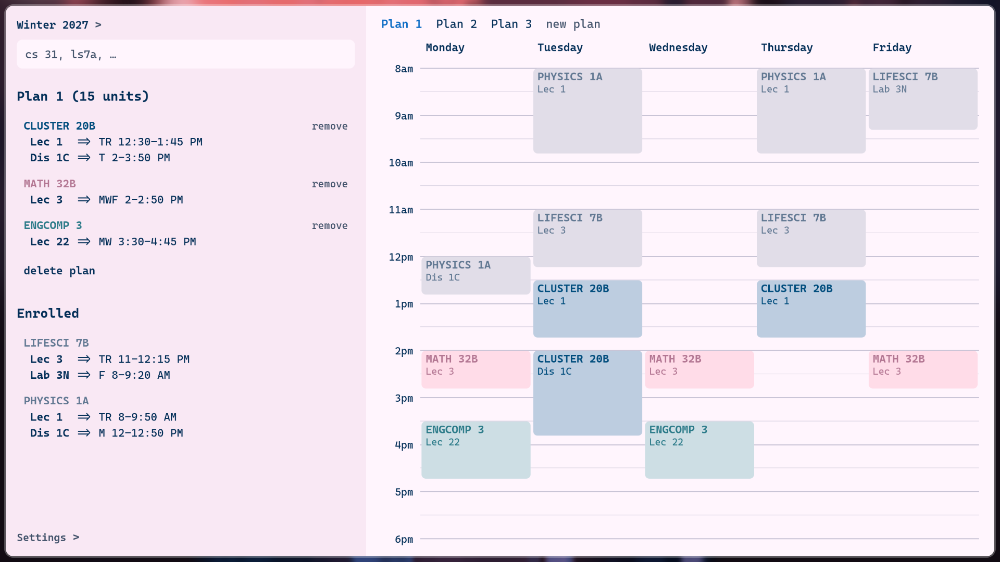

# ucla class planner

## arch setup
`sudo pacman -S webkit2gtk-4.1`  
`npm i`  
`npm run tauri dev`  

then build with  
`npm run install-app`

## planning on adding
enrollment 😉😉😉  
proper sync for multiple plans  
decision trees (w/ ai prefs?)  
alternates
